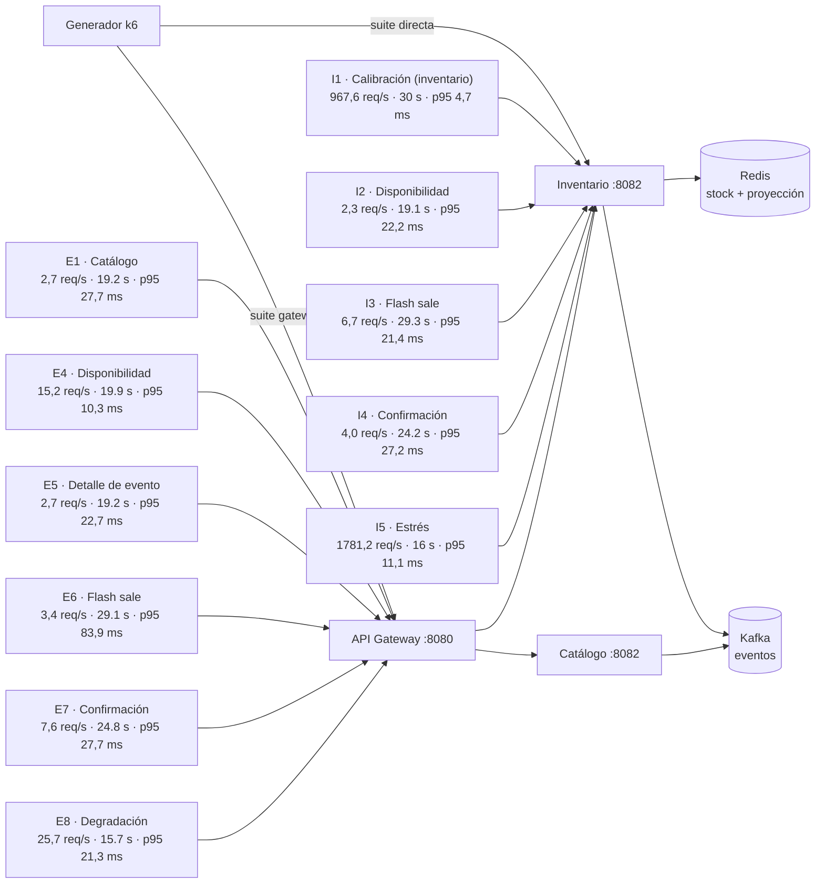
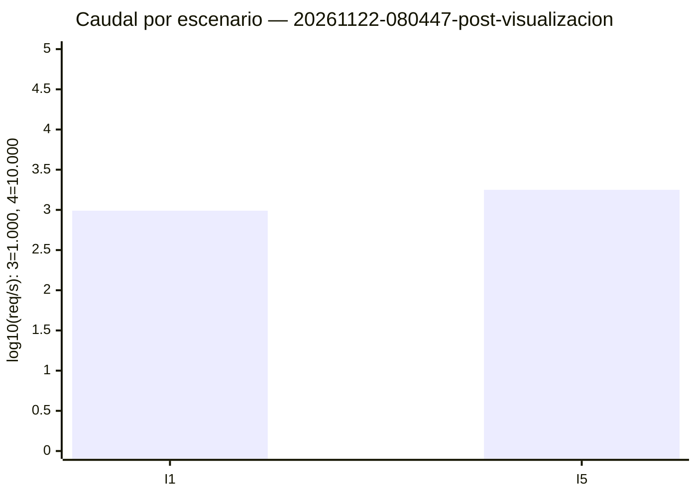
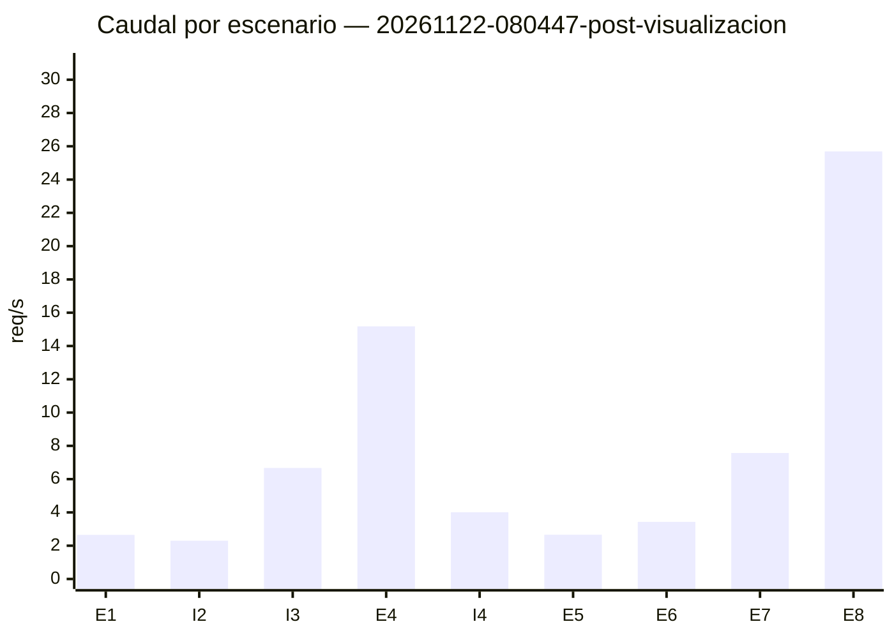
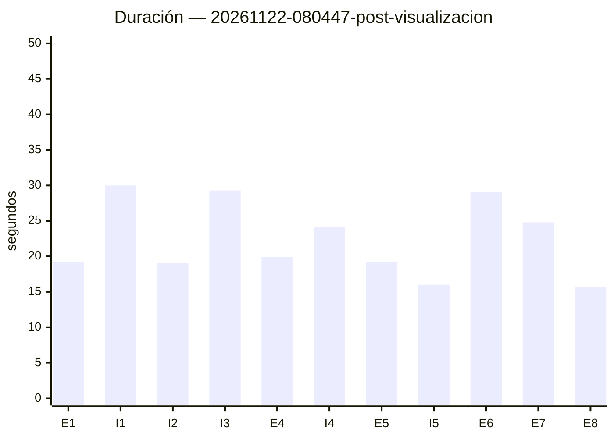

# Anexo visual — pruebas de carga de TicketFlow

> Generado automáticamente por `scripts/generate-visual-report.js` desde los `run.json` de `results/sessions/`.
> **No ejecuta pruebas de carga para generar el anexo.** Los datos son de las sesiones del 2026-11-15, la verificación del 2026-11-21 y el reporte completo `post-visualizacion` del 2026-11-22.

> **Replay interactivo:** abre `visual/replay-interactivo.html` para ver petición por petición dónde se acepta o se rechaza y por qué. Ambos visores tienen selector de sesión; `post-visualizacion` viene seleccionada por defecto.

## Cómo leerlo

- **req/s** = peticiones HTTP por segundo, no paquetes TCP.
- Peticiones, req/s y duración cuentan solo la fase `main`. El `setup` es preparación y se excluye; en el replay se puede mostrar con «Mostrar setup».
- **CPU %** está relativo a un núcleo: puede superar 100 % cuando el servicio usa varios hilos.
- **p95** es el percentil 95 de duración de petición; es la métrica válida en este entorno compartido (el plan descarta p99 como umbral).
- Las barras de caudal usan **log10(req/s)** para que escenarios de 10 req/s y de 4 000 req/s quepan en la misma gráfica. En el eje, `3` = 1.000 req/s y `3,3` ≈ 2.000; es el exponente, no `10^1000`. I5: `log10(1.781,2) = 3,2507` → `10^3,2507 ≈ 1.781` req/s.
- La duración se calcula entre `startedAt` y `finishedAt` de cada `run.json`; puede diferir unos segundos de la duración impresa en el `SUMMARY.md`.

## ¿Por qué cambia el req/s entre sesiones si es el mismo escenario?

El req/s **no es una configuración fija**: es `peticiones totales / duración real` de cada corrida.
Cambia entre sesiones aunque el escenario sea el mismo porque:
1. El perfil cambia los `stages` y el número de VUs (las sesiones `smoke` son más cortas que `local`).
2. La suite directa a inventario no pasa por el `RequestRateLimiter` del gateway (10 req/s, ráfaga 20); la suite gateway sí, por eso sus cifras son mucho menores.
3. k6 espera la respuesta antes de la siguiente iteración: un servicio más lento reduce el req/s aunque haya los mismos VUs.
4. En flash sale, las respuestas 409 por cupo agotado siguen contando como peticiones y el cliente sigue reintentando: sube el total y se alarga la duración.
5. El equipo tiene más contenedores levantados en unas sesiones que en otras (Redis, Kafka, ES, LocalStack, frontend).
6. Con `-ReplayJson`, k6 vuelca el JSON **después** de medir: la duración de la carpeta incluye ese vuelco, pero el req/s se calcula sobre la ventana real de carga (I1: 29.033 peticiones / 30,25 s = 959,9 req/s, aunque la carpeta tarde 535 s).

## Qué mide cada escenario

| Escenario | Endpoint | Qué hace | Carga de referencia (perfil `local`) | Esperado |
|---|---|---|---|---|
| E1 · Catálogo | GET /api/eventos (vía gateway) | Lista el catálogo de eventos; mide latencia de lectura cacheable. | 20 s a 5 VUs · 60 s a 25 VUs · 20 s ramp-down | 200; sin 5xx. Es la línea base de catálogo antes de DA-009. |
| E4 · Disponibilidad | GET /api/inventario/eventos/{eventId}/disponibilidad (vía gateway) | Consulta el contador atómico de cupos por localidad. | 20 s a 4 VUs · 60 s a 8 VUs · 20 s ramp-down | 200 o 429 del rate limiter del gateway; nunca 5xx. |
| E5 · Detalle de evento | GET /api/eventos/{eventId} (vía gateway) | Lee el detalle de un evento publicado (catálogo). | 20 s a 5 VUs · 60 s a 25 VUs · 20 s ramp-down | 200 con el evento completo; sin 5xx. |
| E6 · Flash sale | GET disponibilidad · POST /api/reservas · POST /api/reservas/{id}/confirmar (vía gateway) | Simula apertura de venta: muchos compradores compiten por 100 cupos. | 10 s a 15 VUs · 100 s a 15 VUs · 10 s ramp-down | 200/201 al reservar, 409 al agotar cupo, 429 por rate limit; invariante stock=0 y nunca negativo. |
| E7 · Confirmación | POST /api/reservas · POST /api/reservas/{id}/confirmar (vía gateway) | Crea y confirma reservas con Idempotency-Key única por petición. | 10 s a 8 VUs · 50 s a 8 VUs · 10 s ramp-down | 200/201 al confirmar; 409/410 en re-confirmaciones; 429 por rate limit; sin 5xx. |
| E8 · Degradación | POST /api/reservas (vía gateway) | Ráfaga sostenida para observar degradación controlada. | 5 s a 40 VUs · 50 s a 40 VUs · 5 s ramp-down | 200/201/409/429; el circuit breaker puede abrir y responder fallback 503 sin corromper Redis. |
| I1 · Calibración (inventario) | GET /api/inventario/eventos/{eventId}/disponibilidad (directo, sin gateway) | Busca el codo de capacidad del servicio de inventario. | 30 s a 10 VUs · 30 s a 25 · 30 s a 50 · 30 s a 75 · 30 s a 0 | 200; sin 5xx. Aquí se midió la CPU de catálogo antes/después de DA-009. |
| I2 · Disponibilidad | GET /api/inventario/eventos/{eventId}/disponibilidad (directo, sin gateway) | Mide disponibilidad sostenida a carga baja constante. | 20 s a 5 VUs · 80 s a 20 VUs · 20 s ramp-down | 200; p95 estable y sin 5xx. |
| I3 · Flash sale | GET disponibilidad · POST /api/reservas · POST /api/reservas/{id}/confirmar (directo) | Prueba clave de concurrencia: 100 cupos, 15 compradores, sin freno del gateway. | 10 s a 15 VUs · 100 s a 15 VUs · 10 s ramp-down · STOCK=100 | 100 reservas aceptadas, el resto 409; stock final 0, nunca negativo; verificado con SQL + Redis. |
| I4 · Confirmación | POST /api/reservas (setup) · POST /api/reservas/{id}/confirmar (directo) | Confirma reservas creadas previamente y comprueba el estado emitido. | 10 s a 10 VUs · 50 s a 10 VUs · 10 s ramp-down | 200/201 con status CONFIRMED; 409/410 en re-confirmaciones; sin 5xx. |
| I5 · Estrés | POST /api/reservas (directo, sin think time) | Contención extrema sobre el contador Redis y la escritura en PostgreSQL. | 5 s a 45 VUs · 55 s a 45 VUs · 5 s ramp-down | 200/201 o 409 por cupo agotado; timeouts controlados, nunca 5xx ni stock negativo. |

> La tabla anterior describe el perfil `local` de referencia. La carga **realmente ejecutada** en cada sesión (stages y stock) se indica en la sección de esa sesión y en el visor HTML.

## Sesión `20261122-080447-post-visualizacion`

Destino predominante: **API Gateway**. 11 escenarios.

| Escenario | Stages ejecutados | Stock sembrado |
|---|---|---:|
| E1 · Catálogo | 5s:2 · 10s:5 · 5s:0 | — |
| I1 · Calibración (inventario) | 10s:3 · 10s:6 · 10s:0 · STOCK=100 | 100 |
| I2 · Disponibilidad | 5s:2 · 10s:4 · 5s:0 | — |
| I3 · Flash sale | 5s:6 · 20s:10 · 5s:0 · STOCK=5 | 5 |
| E4 · Disponibilidad | 5s:2 · 10s:4 · 5s:0 | — |
| I4 · Confirmación | 5s:4 · 15s:6 · 5s:0 | — |
| E5 · Detalle de evento | 5s:2 · 10s:5 · 5s:0 | — |
| I5 · Estrés | 3s:15 · 10s:15 · 3s:0 · STOCK=100 | 100 |
| E6 · Flash sale | 5s:6 · 20s:10 · 5s:0 · STOCK=5 | 5 |
| E7 · Confirmación | 5s:4 · 15s:6 · 5s:0 | — |
| E8 · Degradación | 3s:20 · 10s:40 · 3s:0 | — |

### Flujo y carga por escenario

Cada caja indica el escenario, el caudal medio, la duración y el p95. La flecha muestra a qué servicio llega el tráfico.

### Caudal alto — log10(req/s)

### Escenarios funcionales — req/s

### Duración de cada escenario (segundos)

| Escenario | Destino | req/s (main) | log10 | Ventana main | p95 | p99 | Fallidas | CPU pico | RAM pico |
|---|---|---:|---:|---:|---:|---:|---:|---:|---:|
| E1 · Catálogo | API Gateway | 2,7 | 0,4232 | 19.2 s | 27,7 ms | 41,1 ms | 0,00 % | 61,4 % | 5631,3 MiB |
| I1 · Calibración (inventario) | Inventario | 967,6 | 2,9857 | 30 s | 4,7 ms | 6,6 ms | 0,00 % | 384,0 % | 5656,7 MiB |
| I2 · Disponibilidad | Inventario | 2,3 | 0,3617 | 19.1 s | 22,2 ms | 184,2 ms | 0,00 % | 28,6 % | 5585,0 MiB |
| I3 · Flash sale | Inventario | 6,7 | 0,8241 | 29.3 s | 21,4 ms | 246,2 ms | 0,00 % | 34,1 % | 5579,2 MiB |
| E4 · Disponibilidad | API Gateway | 15,2 | 1,1813 | 19.9 s | 10,3 ms | 26,0 ms | 0,00 % | 31,1 % | 5634,1 MiB |
| I4 · Confirmación | Inventario | 4,0 | 0,6031 | 24.2 s | 27,2 ms | 406,0 ms | 0,00 % | 55,3 % | 5577,7 MiB |
| E5 · Detalle de evento | API Gateway | 2,7 | 0,4249 | 19.2 s | 22,7 ms | 109,2 ms | 0,00 % | 29,9 % | 5634,8 MiB |
| I5 · Estrés | Inventario | 1781,2 | 3,2507 | 16 s | 11,1 ms | 14,5 ms | 0,00 % | 661,1 % | 5660,0 MiB |
| E6 · Flash sale | API Gateway | 3,4 | 0,5353 | 29.1 s | 83,9 ms | 206,3 ms | 0,00 % | 33,3 % | 5639,4 MiB |
| E7 · Confirmación | API Gateway | 7,6 | 0,8791 | 24.8 s | 27,7 ms | 199,6 ms | 0,00 % | 33,7 % | 5607,5 MiB |
| E8 · Degradación | API Gateway | 25,7 | 1,4098 | 15.7 s | 21,3 ms | 180,1 ms | 0,00 % | 55,6 % | 5587,9 MiB |

## Antes y después de DA-009

Sesión anterior: `20261115-095106` · sesión de verificación: `20261121-215331-post-da009`.

| Métrica | Antes (15-Nov) | Después de DA-009 |
|---|---|---|
| CPU media de catálogo (I1) | 209,54 % (30 muestras) | **1,21 %** (9 muestras) |
| GET de inventario a `/localidades` | 1 por petición (código anterior; sin métrica en 15-Nov) | **0** en 321.362 lecturas de disponibilidad |
| p95 de disponibilidad (I1, alta carga) | 18,7 ms @ 3317,5 req/s | 29,3 ms @ 2098,6 req/s |
| p95 de disponibilidad (I2, carga sostenida) | 3,9 ms @ 10,2 req/s | 10,2 ms @ 10,1 req/s |
| Fallidas / checks | 0,00 % fallidas · checks 100,00 % / 100,00 % / 100,00 % | 0,00 % fallidas · checks 99,99 % / 99,96 % / 100,00 % |
| Invariante anti-sobreventa (I3) | PASS · 100 reservas, stock 0 | PASS · 100 reservas, stock 0 |

> Resultado de la verificación: **3/3 escenarios PASS**. El flash sale tardó 31 min 40 s porque el cliente siguió reintentando después de agotar el cupo; los 409 son rechazos esperados (`http.expectedStatuses(200,201,409)`), no fallos.
> La CPU de catálogo cayó de 209,54 % a 1,21 % en I1, pero el caudal también bajó de 3.317,5 a 2.098,6 req/s y solo se tomaron 9 muestras (antes 30): es una señal direccional, no un benchmark a igual carga.
> El p95 **no mejoró** (I1: 18,7 → 29,3 ms; I2: 3,9 → 10,2 ms). DA-009 eliminó el acoplamiento HTTP; no era una optimización de latencia, y el stack actual tiene más contenedores levantados que en la sesión anterior.

## Archivos visuales

- `visual/resumen-carga.svg` — imagen estática para insertar en diapositivas.
- `visual/resumen-carga.html` — vista interactiva (selecciona sesión) para abrir en el navegador.
- Este archivo — diagramas Mermaid que se renderizan en GitHub o VS Code.

